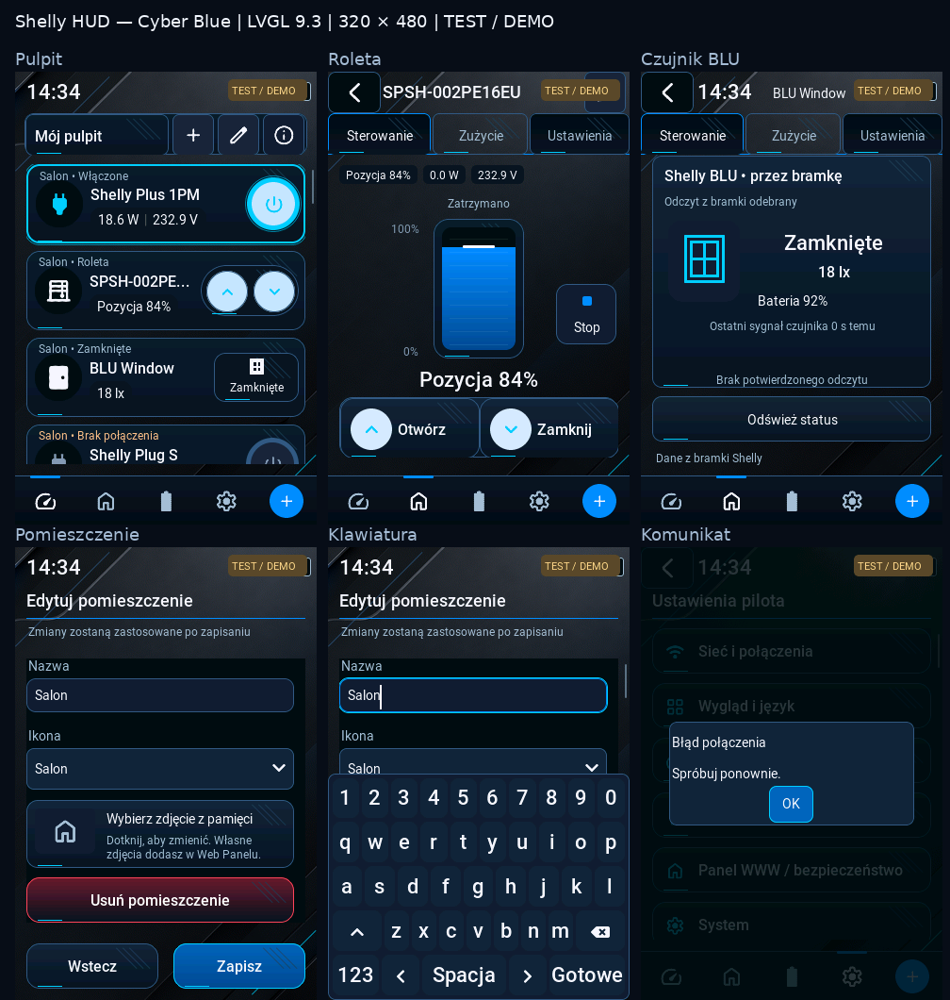

# Shelly HUD — Cyber Blue

Opcjonalna czwarta skórka istniejącego systemu wyglądu. Baza implementacji:
`e6e2359` (`work/p0-spiffs-ota-brand`, 0.7.57-dev), ESP-IDF 5.5.4,
LVGL 9.3.0 (`c033a98afddd65aaafeebea625382a94020fe4a7`), ES3C35P 320 × 480.

## Wybór i zachowanie danych

Ustawienia → Wygląd i język → Motyw → **Shelly HUD — Cyber Blue** → Zapisz.
Ta sama opcja jest dostępna w istniejącym selektorze Web Panelu. Identyfikatory
0 `graphite`, 1 `midnight`, 2 `light` pozostają bez zmian. Nowy: 3 `cyber_blue`.
Domyślna konfiguracja nadal wybiera Grafit. Pole `accent` nie jest nadpisywane:
Cyber Blue używa własnej palety, a powrót przywraca zapisany akcent użytkownika.

Zapis korzysta z istniejącej walidacji, rewizji CAS, dwóch punktów kontrolnych
workspace i potwierdzenia trwałego zapisu. Anulowanie nie zmienia aktywnej skórki.
Przełączenie przebudowuje widok bez restartu. Przy starcie workspace odtwarza
skórkę; istniejąca wskazówka NVS `dsr_ui/style` rozpoznaje również wartość 3,
aby ekran startowy wybrał dotychczasową ciemną grafikę.

## Implementacja

- `dsr_ui_style.*`: czwarty identyfikator i mapowanie nazwy, wspólne kolory,
  karty, przyciski, ikony, nawigacja i akcenty HUD.
- `dsr_ui_cyber.*`: paleta, współdzielone style i nakładka na standardowy motyw
  LVGL. Obejmuje pola, dropdowny i ich listy, checkboxy, klawiatury i macierze
  przycisków, suwaki, wskaźniki, rolki oraz standardowe msgboxy z przyciemnieniem.
- `dsr_ui_config.c`, `dsr_config.c`, `panel.js`, `dsr_style_hint.c`: rozszerzenia
  istniejącego wyboru i zapisu. Bez drugiego selektora i bez kopii ekranów.

Wszystkie ekrany korzystają z tych samych komponentów; własne dialogi błędów,
potwierdzenia usuwania, kreatory i formularze otrzymują tę samą paletę. Główne
akcje są niebieskie; usuwanie zachowuje czerwony kolor i potwierdzenie. Ciemniejsze
wypełnienia przycisków utrzymują czytelność jasnych napisów. Nie zmieniono
komunikacji, sterowania Shelly, sieci, partycji, kluczy, logiki OTA ani wersji.

Wykorzystano oryginalne ciemne tło i istniejący atlas ikon, bez zmiany bajtów
dotychczasowych zasobów. Ukośne metaliczne kreski i turkusowe obramowania są
rysowane bezpośrednio przez LVGL. Nie dodano bitmap ani dekodera. Nie ma blur,
animacji HUD, dodatkowego timera ani kopiowania tła do RAM. Efekt aktywności
korzysta z cienkiego obrysu zamiast kosztownego cienia.

Style Cyber Blue inicjalizują się przy pierwszym wybraniu. Ich ograniczony,
współdzielony zestaw zostaje do ponownego użycia po zmianie skórki. Nie jest
resetowany, gdy istnieją obiekty posiadające referencje. Struktura motywu jest
umieszczona w PSRAM na ESP32. Użyto konkretnej struktury motywu z przypiętego
LVGL 9.3 (`lv_theme_private.h`); aktualizacja LVGL wymaga ponownej kompilacji
i testów tego miejsca.

## Sprawdzone lokalnie

- Istniejące testy rzeczywistego LVGL: 344 wcześniejsze obrazy identyczne
  piksel w piksel z bazą. Dotyczy także trzech wcześniejszych skórek.
- Nowy test Cyber Blue: wybór, zapis, anulowanie, odczyt zapisanej konfiguracji,
  cztery skórki, klawiatura, polskie glify w natywnym komunikacie, dropdown,
  dialog usuwania i wywołanie callbacku sterowania przez wskaźnik.
- 80 zapisanych przełączeń po rozgrzaniu cache: **112 144 → 112 144 B** wolnej
  pamięci LVGL, największy blok **86 792 B**, pomiar na pustym, uspokojonym ekranie.
  Pierwszy wybór na ekranie wyglądu: **100 488 → 99 856 B** wolnych; różnica
  obejmuje także leniwe cache i odmienne style widżetów, nie tylko sam motyw.
- 24 kafelki urządzeń: **10 256 B** wolnych, największy blok **10 208 B**,
  rzeczywista pula LVGL **128 KiB**, bez podnoszenia limitu.
- Test konfiguracji z UBSan: **7338 sprawdzeń**, w tym zapis/odczyt wszystkich
  skórek przez rzeczywisty magazyn dwóch punktów kontrolnych na dysku hosta.
  Ten sam nowy test z kodem schematu sprzed zmiany odrzuca `cyber_blue`.
- Rzeczywista implementacja wskazówki NVS: sześć świeżych procesów testowych,
  stary/nowy/nieznany identyfikator, brak danych, zapis tylko przy zmianie,
  nieudany commit. Same wywołania NVS są modelem.
- Składnia `panel.js` oraz `git diff --check`.

Wyniki CI należy wiązać z dokładnym commitem gałęzi. Lokalne ASan/LSan w tym
kontenerze jest ograniczone brakiem dostępu do `/proc`; UBSan działa. Pełne
ASan/LSan i docelowy build są obsługiwane przez istniejące GitHub Actions.

## Podglądy i odbiór sprzętowy

W katalogu `cyber-blue` są PNG z rzeczywistego renderera LVGL 320 × 480.
Napisy TEST / DEMO oznaczają modele danych/radia; przykładowa wersja firmware
na podglądzie pochodzi z fixture. Nie są to fotografie urządzenia.

Nie przeprowadzono testów na fizycznej płytce. Do odbioru na ES3C35P pozostają:
zmiana i restart dla wszystkich czterech skórek, powrót do poprzedniego akcentu,
okna/klawiatura i czytelność na LCD, rzeczywiste sterowanie i STOP, pomiary
heap/PSRAM oraz opóźnień dotyku. Testy hostowe nie dowodzą tych wyników.
Ta gałąź nie publikuje wydania, nie podpisuje firmware i nie zmienia `main`.
