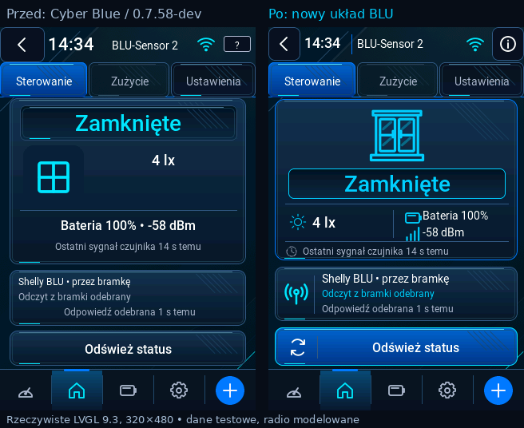
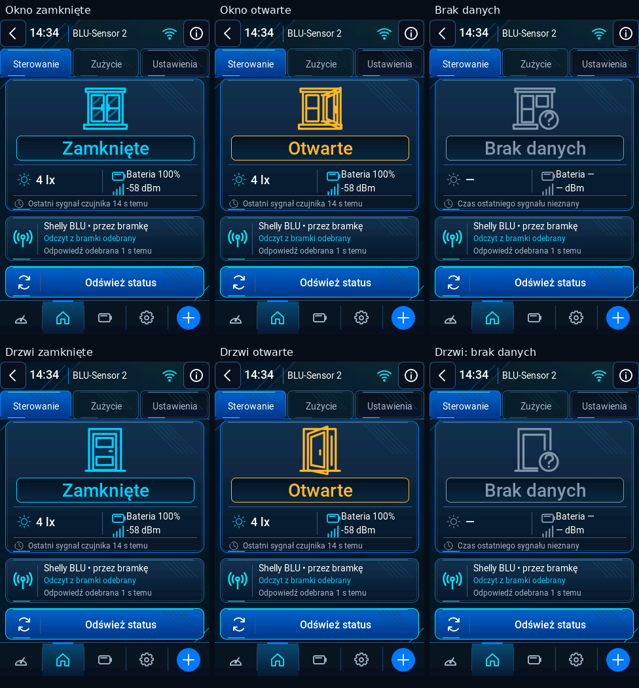
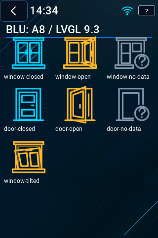

# Cyber Blue Premium — nowy ekran Sterowanie BLU

To rzeczywiste obiekty LVGL 9.3.0 na powierzchni 320 × 480, z produkcyjnego
`dsr_ui_mobile.c`. Rendery używają danych fixture; nie są testem radia ani
fizycznego wyświetlacza. Wartości w firmware pochodzą z istniejącego modelu
odczytanego przez bramkę. Protokół, parser, zapis konfiguracji i callback
`refresh` pozostają bez zmian.





## Układ

| Obszar | Położenie / rozmiar |
|---|---|
| Nagłówek | y=0…43, Wstecz, wspólny zegar, nazwa 14 px z wielokropkiem, Wi-Fi, lokalna informacja |
| Zakładki | istniejące y=44…87, Sterowanie / Zużycie / Ustawienia i te same callbacki |
| Zawartość | x=8, y=90, 304 × 334, przewijanie tylko w pionie |
| Karta czujnika | min. 202 px; centralna maska 80 px, status 28 px, lx 18 px, bateria/RSSI 14 px, wiek 12 px |
| Karta bramki | min. 68 px; osobny status komunikacji i czas odpowiedzi |
| Odświeżanie | szerokość 304, wysokość 48 px; normalny, wciśnięty, oczekiwanie i nieaktywny |
| Dolna nawigacja | dotychczasowe y=428…479, te same ikony, kolejność i działanie |

Zwykły wariant mieści się bez przewijania. Dłuższe komunikaty i dodatkowe
pomiary temperatury/wilgotności/przycisku zwiększają wysokość odpowiedniej
karty. Zachowuje się pozycję przewijania przy zmianie odczytu.

## Stan i symbol

- Rodzina drzwi wynika z zapisanego symbolu **Drzwi**; dotychczasowy domyślny
  kontakt to okno. Nazwa, MAC i tekst modelu nie służą do zgadywania symbolu.
- Zamknięte: `#00CFFF`. Otwarte: `#FFB52E`. Brak danych: `#8295AB`.
- Zamknięcie/otwarcie wymaga online, `DSR_OK`, flag `VALID` i `HAS_OPEN` oraz
  braku błędów BTHome. Bez tych przesłanek pojawia się **Brak danych**, również
  po utracie bramki lub błędzie klucza. Samo otwarcie nie jest alarmem.
- Czas sygnału czujnika (`blu_age_s`) pozostaje oddzielny od czasu odpowiedzi
  bramki (`sample_ms`). Nieznany czas nie jest zastępowany przykładową liczbą.
- Model danych nie zawiera stanu uchylenia ani osobnego alarmu kontaktu.
  `window-tilted` jest przygotowanym zasobem, pokazanym w galerii ikon; nie
  występuje jako wymyślony stan urządzenia. Nie dodano flag ani progów tilt.
- Inne BLU zachowują ruch, temperaturę, wilgotność i przycisk. TRV korzysta
  z dotychczasowego osobnego widoku.



## Weryfikacja na hoście

- `python3 tools/test_ui.py --jobs 1`: pełny zestaw rzeczywistych ekranów LVGL
  przeszedł. Nowy przypadek: **891 kontroli, 169 renderów**, PL/EN/DE, stany,
  długie nazwy, dotyk, wciśnięcie przycisku, brak akcji przy blokadzie,
  przewijanie palcem, zachowanie pozycji, zakładki i modal podczas odczytów.
- `python3 tools/test_ui.py --case test_blu_ui --jobs 1`: **258 kontroli**,
  istniejący LAN/BIND/typed gateway i PROBE, brak nowego SET. Odpowiedzi bramki
  przechodzą przez istniejący model do stanów Zamknięte, Otwarte, Brak danych.
- `C_INCLUDE_PATH="$PWD/.test-deps" python3 tools/test.py`: pełny zestaw hostowy
  zakończony powodzeniem.
- **344** wcześniejsze rendery i **99** dodatkowych wariantów trzech starszych
  skórek w PL/EN/DE są identyczne bajtowo przed/po. Nie zmieniono palet,
  zapisanych identyfikatorów, listy symboli konfiguracji, domyślnej skórki ani
  oryginalnych plików zasobów. Nowe role ikon dopisano na końcu enum.
- Istniejący test Cyber Blue przeszedł **80 zapisanych przełączeń skórek**;
  edytory przeszły **60 cykli** otwarcia klawiatury/pokoju i baterii.
- Lokalna próba ASan napotkała ograniczenie środowiska LeakSanitizer/ptrace.
  Nie jest liczona jako zaliczony lokalny LSan. Pełne ASan/LSan/UBSan oraz
  kompilację targetu wykonuje niezmieniony workflow
  [Firmware checks](https://github.com/voltex-at/DIY-Shelly-Remote/actions/workflows/ci.yml?query=branch%3Awork%2Fshelly-hud-cyber-blue).
  Wynik dla konkretnego commitu i dane ELF należy odczytać z tego uruchomienia.

## Pamięć i wydajność

| Pomiar | Wynik |
|---|---:|
| Nowe statyczne maski A8 (31 sztuk) | 73 856 B danych źródłowych Flash + deskryptory |
| Fonty | bez nowych fontów |
| Pula LVGL | bez zmiany: 131 072 B w PSRAM |
| Stos UI | bez zmiany: 8192 B w pamięci wewnętrznej |
| Wolne LVGL, ekran przed / po | 96 576 / 93 504 B |
| Dodatkowe użycie istniejącej puli, host 64-bit | **3072 B** |
| 80 otwarć/zamknięć, ten sam pusty punkt kontrolny | 111 328 → 111 328 B wolne |
| Największy blok po tych cyklach | 91 656 B |

Porównanie przed/po używa tej samej konfiguracji LVGL, kompilatora, fixture i
rozgrzania cache. Wariant bazowy linkuje `dsr_ui_mobile.c` i mapper ikon z
niezmiennego `dev-v0.7.58`. Reprodukcja: `python3 tools/measure_cyber_blu_heap.py`.
Wyniki hosta uwzględniają wskaźniki 64-bit i nie są pomiarem heap ESP32.
Całkowity przyrost obrazu Flash może być mniejszy od sumy nowych masek: linker
może pominąć zastąpione, nieużywane warianty; ich pliki źródłowe zachowano.

Brak nowego bufora grafiki, dekodera SVG/PNG, timera, animacji, blur lub cienia.
Ikony są const A8 w Flash i korzystają z dotychczasowego kolorowania LVGL.
Nie podniesiono limitu BSS ani stosów, aby uzyskać pozytywny wynik kompilacji.

## Odtworzenie renderów i pliki

```
python3 tools/test_ui.py --case test_cyber_blu_ui --jobs 1
python3 tools/test_ui.py --case test_blu_ui --jobs 1
python3 tools/measure_cyber_blu_heap.py
python3 tools/render_cyber_blu.py
python3 tools/check_cyber_icons.py
```

- Układ: `components/dsr_ui/dsr_ui_mobile.c`.
- Nagłówek i dopisane role: `dsr_ui_style.c/.h`.
- Mapper: `dsr_ui_cyber_icons.c`; maski: `cyber_icons/shelly_hud_blu.c/.h`.
- Wektory i transparentne PNG 24/32/48/80: `assets/cyber-blu-icons/`.
- Generator: `tools/build_cyber_blu_icons.py`; testy i źródło danych:
  `tests/ui/test_cyber_blu_ui.c`, `tests/ui/test_blu_ui.c`.
- `before/baseline-0…4.png`: ten sam model danych w dotychczasowym układzie,
  z kodu `dev-v0.7.58`; bez nakładki testowej zasłaniającej nagłówek.
- `native-820…854`: stany i języki; `native-858`: siedem ikon;
  `native-860`: rzeczywista ścieżka bramki na hoście; `native-861…863`:
  wciśnięty przycisk, przewinięta zawartość i lokalna informacja.

## Do sprawdzenia na ESP32-S3

Nie przeprowadzono testów na fizycznym urządzeniu. Pozostają: czytelność LCD
w docelowej jasności, precyzja dotyku/przewijania, rzeczywiste stany okna/drzwi,
zanik Wi-Fi lub bramki, czasy odświeżania oraz wolna i szczytowa RAM/PSRAM SDK
przy jednoczesnym BLE/HTTPS. Testy hosta nie potwierdzają tych pomiarów.
