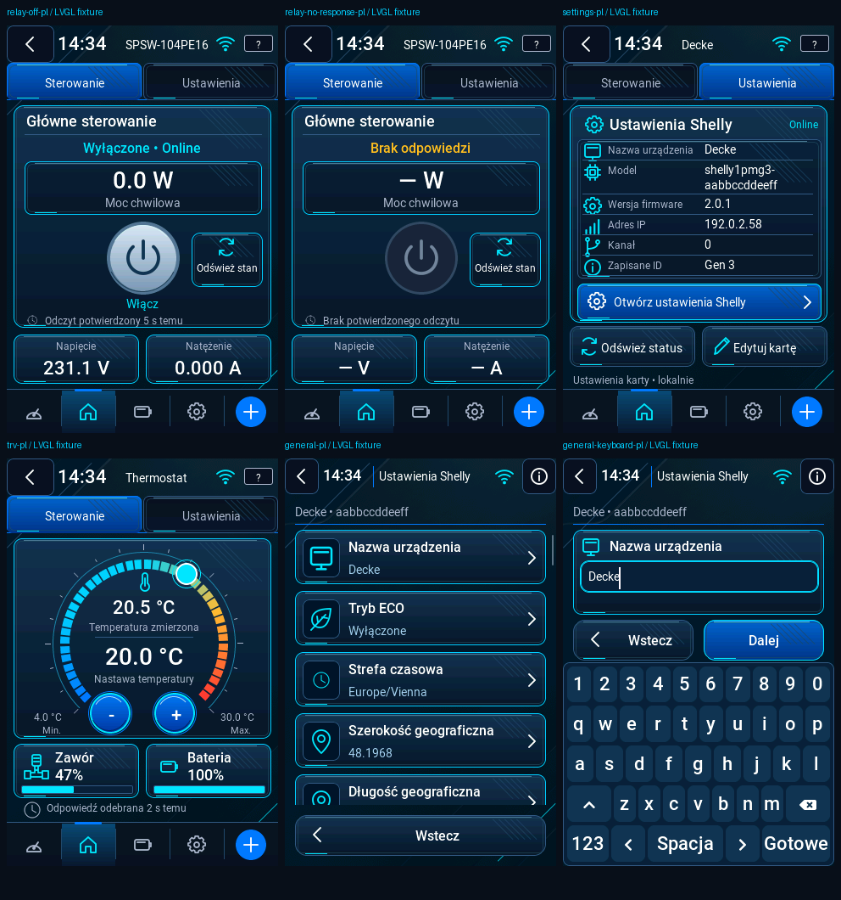

# Cyber Blue — integracja 0.7.61-dev



Rendery pochodzą z kodu firmware i przypiętego LVGL 9.3.0, RGB565,
320×480. Transport, zegar i dane są dostawcami testowymi hosta.
Nie są to zdjęcia fizycznego pilota. `render-manifest.json` zawiera sumy
plików oraz surowych pikseli. Eksport PPM → PNG nie zmienia pikseli UI.

## Porównanie z referencjami dostarczonymi 2026-10-20

| Referencja | Wynik integracji | Zamierzone różnice |
| --- | --- | --- |
| Przekaźnik wyłączony / brak odpowiedzi | Panel mocy, przycisk 86 px, akcja odświeżania, osobne V/A; nieznane dane `—` | Dwie zakładki zamiast trzech, zgodnie z późniejszym opisem. Większy powrót z 0.7.60 pozostaje. |
| Termostat | Segmentowy pierścień blue/cyan/amber/red, wskaźnik, 22/28 px, −/+ 48 px, zawór/bateria z paskami 10 px | Kontur zaworu odtworzony jako nowa maska A8. Dane przykładów nie są telemetrią. |
| Ustawienia urządzenia | Sześć osobnych wierszy, stan po prawej, główny przycisk bez przewijania, stałe Odśwież/Edytuj | Tożsamość/IP przykładów zanonimizowane. Widok otwiera natywny edytor; nie udaje przeglądarki. |
| Ogólne / przewinięcie / klawiatura | Scalony załączony plik C; karty 64 px, ikona, wartość, rzeczywiste edytowalne pola, stały powrót, klawiatura od y=240 | Ikony ECO/lokalizacji odtworzone; pola wynikają z aktualnego GetConfig. Brak fikcyjnego regionu/języka urządzenia. |
| Roleta — ustalenia z kontekstu projektu | Pancerz wysuwa się z górnej kasety; 0% zamknięte, 100% otwarte; STOP zatrzymuje wizualizację | Brak nowego obrazu referencyjnego rolety w tej paczce. Sprawdzono kierunek i kolejne klatki, bez deklaracji identyczności ze starszą nieudostępnioną grafiką. |

Ocenę wizualną wykonano dla PL/EN/DE, stanów online/offline, oczekiwania,
braku danych i błędu. Ekran termostatu nie pokazuje lx z nakładającego się
pola modelu. Niewysłana nastawa ma bursztynowe oznaczenie oczekiwania.
Nie zmienia potwierdzonego odczytu. Przeciąganie i −/+ aktualizują istniejące
obiekty. Zapis nadal odbywa się raz po 1200 ms.

Roleta korzysta z natywnej animacji LVGL 300 ms między kolejnymi
potwierdzonymi pozycjami ruchu. Numeryczny stan zawsze pochodzi z odczytu.
Nie ekstrapoluje dojścia do celu. STOP/fault zatrzymuje animację, a usunięcie
widoku anuluje jej callback przed zwolnieniem stanu. Bufor dotyku, transport
STOP/readback i poprawki OTA z 0.7.60 pozostają wspólne.

## Weryfikacja tej integracji

- Pełny `tools/test_ui.py --ubsan-only`: produkcyjny GUI, LVGL i dotychczasowe
  regresje; zachowane wszystkie wcześniejsze przypadki oraz negatywne testy.
- `test_cyber_recovered_ui`: 423 kontrole i 72 klatki PL/EN/DE, rzeczywiste zdarzenia wskaźnika,
  regulacja TRV bez przebudowy obiektów, 1200 ms, anulowanie offline,
  progresja pikseli zamykanej rolety, STOP, osobny podgląd celu, nawigacja,
  edycja sześciu pól Sys, anulowanie, odrzucenie szerokości 91° bez SET.
- `test_cyber_blu_actor_ui`: 261 kontroli, rzeczywisty aktor/fleet i nowy regulator z
  testowym transportem; jedna komenda do właściwej bramki/kanału,
  potwierdzenie po odpowiedzi, błąd, brak sterowania offline i lista TRV.
- Ustawienia model/aktor: 1684 kontrole; prywatność podglądu: 53.
- Dotyk: 153 kontrole czterech motywów, zaniki i buforowane gesty.
- 100 otwarć przekaźnika/ustawień: wolna sterta LVGL 111288 → 111288 B.
  80 zapisanych przełączeń motywów po rozgrzaniu: 111184 → 111184 B,
  220 → 220 zajętych bloków. Zmieniony układ wymagał ustabilizowania
  podziału bloków TLSF; nie obniżono warunku braku dalszego wzrostu.

Pula LVGL pozostaje 128 KiB, stos UI 8192 B. Trzy nowe maski A8 zajmują
3072 B Flash plus deskryptory. Stare maski mają zachowane bajty.
Liczby sterty są pomiarami hosta, nie RAM/PSRAM fizycznego ESP32-S3.
Pełny target i ASan/UBSan są bramką CI tego commitu przed wydaniem.

Odtworzenie:

```sh
python3 tools/test_ui.py --ubsan-only --case test_cyber_recovered_ui
python3 tools/test_ui.py --ubsan-only --case test_cyber_blu_actor_ui
python3 tools/render_recovered.py
```

Odbiór fizyczny: dotyk/scroll bez przypadkowych akcji, pokrętło i pojedyncza
nastawa przez bramkę, rzeczywisty ruch rolety i STOP/readback, czytelność LCD
oraz instalacja Dev OTA przy stabilnym zasilaniu. To pozostaje do testu właściciela.
