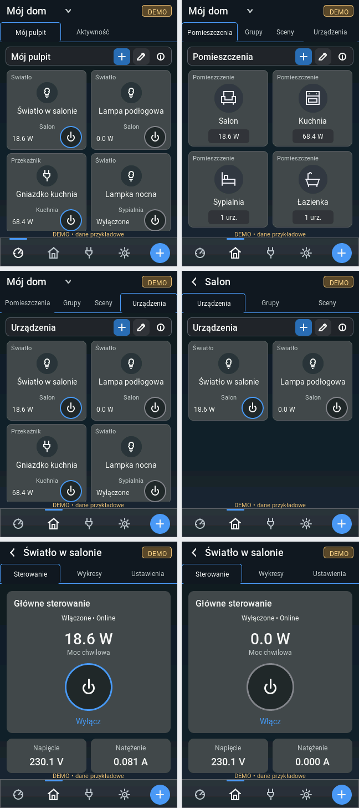

# UI review v2 — actual LVGL, 320×480

Branch: `ui/shelly-smart-control`. Reference: `reference/0.2.0-local-dev`.
The pending Wi-Fi work is separately preserved in `work/wifi-onboarding`.
Nothing in this review is merged to `main` or published as a stable release.



All populated frames are visibly **DEMO**. Test data lives in `tests/ui/test_ui_review.c`, which is not included in ESP-IDF firmware. `08-live-empty.png` shows the real empty state without any invented devices/measurements. OFF and offline variants are included; unknown/offline measurements use an em dash, never a fabricated zero.

| View | File |
| --- | --- |
| Home / favourites | [01-home.png](renders/01-home.png) |
| Rooms | [02-rooms.png](renders/02-rooms.png) |
| All devices / reusable device cards | [03-devices.png](renders/03-devices.png) |
| Room devices | [04-room-salon.png](renders/04-room-salon.png) |
| Device details / ON | [05-device-details-on.png](renders/05-device-details-on.png) |
| Device details / OFF | [06-device-details-off.png](renders/06-device-details-off.png) |
| Offline / unconfirmed measurements | [07-device-offline.png](renders/07-device-offline.png) |
| Empty real mode | [08-live-empty.png](renders/08-live-empty.png) |
| Original icon alignment proof | [09-icon-alignment.png](renders/09-icon-alignment.png) |

## Icon correction requested on 2026-10-15

The user's zoomed review exposed a real alignment bug: manually positioning a
child at `(parent_size-icon_size)/2` ignores the parent's LVGL border inset.
This shifted the glyph inside the 40px/2px-border and 86px/3px-border power
buttons. All circular/button icon placements now share `dsr_sc_icon_centered`,
which aligns against the actual content box. The navigation's plus circle also
uses the same layout alignment rather than a separate vertical offset.

Bulb, plug, room, back and chevron geometry has been balanced in the original
24-unit viewbox. Power and small asymmetrical outlines have explicit optical
corrections; strokes are 2px at small sizes and 3px at 32px and above. Tiny dots
are filled circles instead of software-renderer-degenerate one-pixel arc rings.
The native fixture checks actual anti-aliased RGB565 glyph bounds (not only
object bounds): all 18 icons, six sizes, and border widths 0–3px, 432 cases.
Every visible glyph's bounding-box centre is within 1px of the circle centre;
the centred object boxes are within 0.5px, the unavoidable odd/even pixel case.
The 320×480 icon sheet is also a real LVGL render, not an image-editor overlay.

The user also requested a persisted PL/EN/DE language selector and OTA.
These are explicitly pending functional work, not implemented by this icon
correction; no OTA installation button or working-update claim is introduced.
This visual revision does not merge the draft or expand further screens.

## Shared implementation

- `dsr_ui_style.h/.c`: palette, typography, panels, text, buttons and original vector icons with shared border-aware centring.
- `dsr_ui_mobile.c`: app shell, top tabs, context toolbar, room/device cards, details, circular power control and fixed bottom navigation.
- `dsr_ui_mobile.h`: bounded snapshot model and existing command callbacks. No UI-owned network calls.
- Roboto at 11/12/14/16/18/28px, including Polish glyphs; RGB565 rendering; 128 KiB LVGL heap.
- `dsr_ui_network.c`: adapter from the existing saved Shelly connection to the new model. Real mode does not invent rooms or voltage/current readings absent from the transport.
- Existing display/touch/backlight and platform files are unchanged from the saved checkpoint. Existing settings, diagnostics, add-device and Wi-Fi views remain accessible; their complete visual migration waits for approval.

Live controls send explicit desired output through the existing worker and wait for readback. Demo controls only affect the local demo model. Offline/busy/unsupported controls are blocked. Disabled group/scene/consumption/edit affordances do not claim implemented features.

## Reproduce

```sh
git clone --depth 1 --branch v9.3.0 https://github.com/lvgl/lvgl.git .test-deps/lvgl
python3 tools/test_ui.py --review
python3 tools/render_review.py --no-run
```

The runner verifies LVGL commit `c033a98afddd65aaafeebea625382a94020fe4a7`, compiles real project C code, renders the RGB565 framebuffer and exports untouched frames as lossless PNG. It does not use HTML or concept-image generation. The manifest records image SHA-256 values. Native fixtures do not replace physical touchscreen/hardware validation.

Visual source analysis and asset differences: [SOURCES.md](SOURCES.md).
